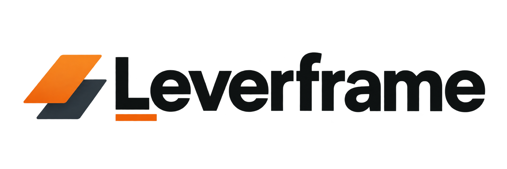
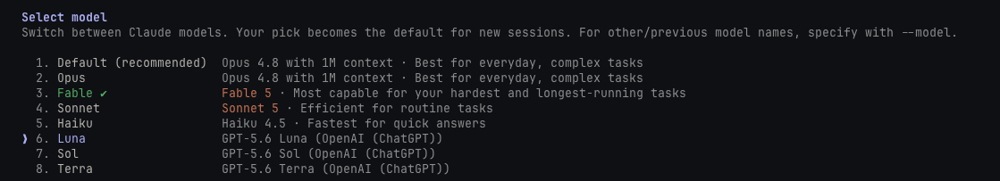

<p align="center">
  
</p>

# Leverframe

[](https://github.com/michaelheichler/leverframe/tags)
[](https://github.com/michaelheichler/leverframe/actions/workflows/ci.yml)
[](https://nodejs.org/)
[](LICENSE)

Use Claude Code with models from other providers. Leverframe handles authentication, model discovery, and request translation while Claude Code manages the conversation, tools, skills, and agents. It also serves local Anthropic and OpenAI-compatible endpoints for other clients.

## What it does

- Discover models and context limits from provider or supplier metadata. Missing limits stay unconfirmed.
- Add multiple accounts for any supported provider, with names and unique 3 to 4 character tags.
- Select an account directly or use an explicit `[AUTO]` pool with configurable balancing and quota failover.
- Display account tags in Leverframe and Claude Code, with orange badges where supported and readable text labels.
- Retain native Claude subscription authentication while external models use their own provider credentials.



## Install

Use Node.js 22 or newer and pnpm 10.34.5. Install Claude Code separately to use its harness, and bring your own provider access.

```bash
git clone https://github.com/michaelheichler/leverframe.git
cd leverframe
pnpm install --frozen-lockfile
pnpm build
npm link --ignore-scripts
leverframe --version
```

The package name is `@michaelheichler/leverframe`. It provides `leverframe`, `leverframe-claude`, and `claudeplus`. Install this fork from the repository or a verified package built from it. Source checkouts do not include `dist/`, so run the build before linking or invoking the CLI.

## Get started

```bash
leverframe providers add
leverframe models
leverframe claude
```

Choose a provider, complete sign-in or enter its API key, then browse discovered models. Use `/model` in Claude Code to switch models. Default proxy mode exposes the freshly available external catalog and retains native Claude models.

For direct OAuth setup, use the relevant command.

```bash
leverframe providers auth openai
leverframe providers auth github-copilot
leverframe providers auth antigravity
```

`claudeplus` prepares a private proxy for each session, while plain `claude` retains its normal routing. After updating Claude Code, run `leverframe patch` and inspect the integration without network access using `leverframe patch --diagnose --json`.

## Providers

| Provider | Authentication |
| --- | --- |
| ChatGPT / Codex | Browser OAuth |
| GitHub Copilot | Device authorization |
| Google Antigravity, experimental | Browser OAuth |
| OpenAI | API key |
| Anthropic API | API key, separate from the Claude subscription |
| OpenCode Go | Subscription API key |
| OpenCode Zen, experimental | Anonymous, free models only |
| Kimi Coding Plan | Plan API key |
| Moonshot | API key |
| z.ai Coding Plan | Plan API key |
| Custom OpenAI-compatible endpoint | API key or anonymous configuration |

Availability depends on which endpoints the account's plan advertises. Copilot and Antigravity use backend interfaces that can change. Antigravity interactive tool continuation checks remain open. See [provider contracts](docs/PROVIDER-CONTRACTS.md) and [Antigravity verification](docs/ANTIGRAVITY-VERIFICATION.md).

Choose **OpenCode Zen (Free, experimental)** in `leverframe providers add` to discover free chat models without an API key or an OpenCode installation. Zen uses the public placeholder credential and OpenCode-compatible session headers, with Leverframe named as the client. Go retains its separate subscription connection. Model discovery does not verify inference access, and OpenCode documents a restriction on free access from other clients. One anonymous verification request returned HTTP 429, so successful inference remains unverified. A server rejection ends the request through normal error handling. See the [Zen research](docs/opencode-zen-research.md) for sources and model privacy terms.

## Accounts and context

Open **Add or manage accounts** beside a configured provider in `leverframe providers add`, or choose **Manage accounts** in its details. Enter a name and a tag such as `WORK`, or leave the tag blank for automatic assignment. Rename either later without changing saved account identities.

Selecting `[WORK]` binds requests to that account without silent alternatives. `[AUTO]` uses eligible accounts according to pool settings. Each account has separate credentials and a model catalog that includes its reported limits.

With failover enabled, Auto handles confirmed credit or quota failures internally and tries another eligible account before exposing an error. It uses real requests, without standalone account probes. Confirmed empty accounts stay blocked until their credential generation changes. If all eligible accounts have confirmed billing exhaustion, Leverframe reports a dedicated message such as “Both accounts are empty.” Unrelated request errors do not establish an empty balance.

Context metadata flows through browsing, routes, and the Claude Code picker. Proxy mode offers default and maximum context when the provider confirms distinct sizes. Auto uses the smallest confirmed context among participating account catalogs, or leaves it unknown when any participating catalog omits it.

See [account management](docs/account-pools.md) and [context selection](docs/CONTEXT-SELECTION.md).

## Routes, aliases, and local servers

External routes use `leverframe:<provider-id>:<model-id>`, with exact IDs from the discovered catalog. Account choices carry their account identity in the model ID. Save an alias with `leverframe models --alias name=leverframe:provider-id:model-id`, replacing the example provider and model with a discovered route.

```bash
leverframe claude --proxy
leverframe claude --endpoint
leverframe server --endpoint --quick
```

Endpoint mode serves `http://127.0.0.1:17645/anthropic` and `http://127.0.0.1:17645/openai/v1` by default. Network listening requires the configured server password. The Claude endpoint picker contains the starting model and saved favorites, up to 20 routes. Context metadata may retain startup values after a live switch in endpoint mode.

For launch settings, environment variables, patch diagnostics, and Keychain repair, read the [Claude Code guide](docs/claude-code.md).

## Development

The build generates `dist/`, and Git ignores it. Commit source changes, not built bundles. CI builds every job before testing and checks deterministic output and package contents in its artifact job. `pnpm pack` and `pnpm publish` build through the `prepack` lifecycle. `pnpm check:package` inspects an existing build with lifecycle scripts disabled, so build first.

```bash
pnpm build
pnpm typecheck
pnpm lint
LEVERFRAME_SKIP_LIVE_PROVIDER_SMOKE=1 pnpm test \
  --exclude tests/live-provider-claude-smoke.test.ts \
  --exclude tests/live-claude-haiku.test.ts
pnpm check:package
```

These commands exclude live Claude conversation suites. See [testing](docs/TESTING.md), [background agents](docs/background-agents.md), and [technical debt](docs/TECH-DEBT.md) for detailed coverage and integration limits.

## Help and releases

Read the [changelog](CHANGELOG.md) for version history. When you [open an issue](https://github.com/michaelheichler/leverframe/issues), include redacted diagnostics and state which Leverframe version runs on your platform. Keep credentials private, including their files.

Michael Heichler maintains this fork. Leverframe derives from [clodex](https://github.com/bman654/clodex) and [relay-ai](https://github.com/jacob-bd/relay-ai). It uses the [MIT license](LICENSE), with upstream notices in [THIRD_PARTY_NOTICES.md](THIRD_PARTY_NOTICES.md).
